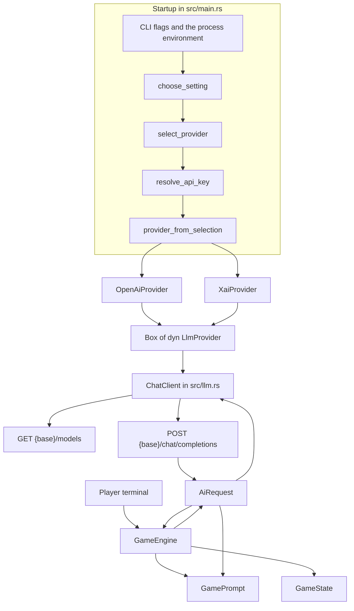

# Grokquest, for Jamie

A field guide to this repo. It assumes you can design a Citrix site or a Terraform stack, and that Rust is the new part.

## 1. What this is

`nutanixguy/grokquest` is a terminal text adventure. A single Rust process asks for your name and a theme, sends that plus the running game state to a chat model, and prints the next scene. The GitHub repo is a fork of `FedeCarollo/ai_dventure`; the Cargo package is still named `ai_dventure` in `Cargo.toml`, and `LICENSE` is the upstream MIT license, copyright Federico Carollo, 2025.

Think of the game as a guest VM and `LlmProvider` as its virtual NIC. OpenAI, xAI, and any OpenAI-compatible endpoint are different physical networks. `AI_PROVIDER` is the port-group uplink. The game calls the trait. The vendor URL stays in `src/llm.rs`.

## 2. Architecture

The process is one binary, `ai_dventure`, built from `src/main.rs`. Nothing in the tree listens on a port. Each turn is one HTTPS request, then the terminal blocks on stdin again.



### Startup, and how `AI_PROVIDER` picks a backend

`src/main.rs` defines `Args` with clap. On startup it reads five environment variables itself (`AI_PROVIDER`, `LLM_PROVIDER`, `AI_MODEL`, `LLM_MODEL`, `AI_BASE_URL`) through `env_nonempty`, which treats a missing or blank value as unset. It does not load a `.env` file. There is no dotenv crate in `Cargo.toml`. Sourcing `.env` in the shell, as `README.md` shows, works only because that puts the names into the process environment before `cargo run`.

`choose_setting` in `src/llm.rs` is the precedence rule: first non-empty of CLI flag, then the `AI_*` variable, then the older `LLM_*` variable. Applied in `main`:

| Setting | Flag | Preferred env | Fallback env | If all are empty |
| --- | --- | --- | --- | --- |
| Provider | `--provider` | `AI_PROVIDER` | `LLM_PROVIDER` | OpenAI |
| Model | `--model` | `AI_MODEL` | `LLM_MODEL` | Built-in default, or an error for `compatible` |
| API root | `--base-url` | `AI_BASE_URL` | none | Built-in host, or an error for `compatible` |

`select_provider` parses the provider name case-insensitively into `ProviderKind`: `OpenAi`, `Xai`, or `Compatible`. Anything else, including `anthropic`, returns an error and the process exits before any HTTP call. A blank provider stays on OpenAI, and a reasoning-effort value is ignored for OpenAI and for `compatible`.

Defaults live next to the enum in `src/llm.rs`:

- OpenAI: `https://api.openai.com/v1`, model `gpt-4o-mini`
- xAI: `https://api.x.ai/v1`, model `grok-4.7`, reasoning effort `low`
- `compatible`: no default host and no default model. `AI_BASE_URL` or `--base-url`, and `AI_MODEL` / `LLM_MODEL` or `--model`, are required

The base URL must start with `http://` or `https://`. Trailing slashes are stripped. `endpoint_url` then joins `chat/completions` and `models`, so you pass the API root (`https://api.x.ai/v1`), not the full chat path. `AI_BASE_URL` also overrides the built-in host for OpenAI and xAI. When OpenAI is pointed at its own host, the model id has to be one of the names in `src/gpt_model.rs`. A custom base URL skips that allow-list, and xAI and `compatible` always take the model string as given.

xAI reasoning effort comes from `--reasoning-effort` or `LLM_REASONING_EFFORT`. Only `low` and `medium` are accepted. The default is `low`.

### The `LlmProvider` trait

`LlmProvider` in `src/llm.rs` is the interface. In Rust a trait is that contract. `Box<dyn LlmProvider>` is a heap pointer to some type that implements it. The trait requires `Send + Sync`. On this multi-thread runtime, `Send` is what lets that pointer be held across an `.await`. The game does not spawn its own tasks.

The trait exposes `name`, `model`, `api_key`, `chat_completions_url`, `models_url`, and `reasoning_effort`. `uses_max_completion_tokens` defaults to false. `XaiProvider` overrides it to true. The comment on that method says xAI bills reasoning separately, so the story budget uses `max_completion_tokens`.

`provider_from_selection` is the factory:

- `OpenAi` and `Compatible` both construct `OpenAiProvider`. The `name()` string is `openai` or `compatible`. Same request shape, different label and key.
- `Xai` constructs `XaiProvider`, which adds `reasoning_effort` and the completion-token switch.

`resolve_api_key` reads only the key for the selected kind. The clap bindings in `src/main.rs` are `--api-key` / `OPENAI_API_KEY`, `--xai-api-key` / `XAI_API_KEY`, and `--ai-api-key` / `AI_API_KEY`. A missing key returns an error that names the variable and does not include the other keys. That behavior is asserted in `src/llm.rs` tests.

Adding a backend with a different JSON shape is the three steps named in the module comment: implement `LlmProvider`, match the name in `ProviderKind` and `provider_from_selection`, and read its key in `resolve_api_key`. An OpenAI-compatible server does not need a new type. Set `AI_PROVIDER=compatible` and the base URL, key, and model.

### What one turn actually does

`main` builds the provider, wraps it in `AiRequest`, and calls `check_api_key` before the game starts. `ChatClient::check_api_key` sends `GET {base}/models` with `Authorization: Bearer`. HTTP 200 continues. Any other status, including a 500 or a 404, becomes `Invalid API key for the {name} provider`. A transport failure returns the reqwest error from `send()` and is left as that transport error. There is no retry.

`GameEngine::start_game` in `src/game_engine.rs` then:

1. Prints the welcome text from `GamePrompt`.
2. Reads a name from stdin. Empty input is kept as an empty name. The code does not substitute a default.
3. Reads a theme number. `GamePrompt::get_themes` has five themes (fantasy, horror, sci-fi, historical, surprise). Menu item 6 asks for a free-text theme. Any other input silently becomes the fantasy theme, which is `themes[0]`.
4. Builds a `GameState` and sets the current prompt to `get_initial_story_prompt`.
5. Calls `AiRequest::json_chat`, prints the story and the numbered choices, and stores the response.
6. Enters `game_loop`.

Every pass of the loop prints status, then reads a line. `quit` and `exit` break. `status` continues, which just prints status again at the top of the loop. Any other line, including the digit `1`, is the player action. The code never looks up `choices[0]` when you type `1`. The digit is sent to the model as the action text.

`json_chat` in `src/ai_request.rs` does not grow a chat transcript. Each call is two messages: a system message from `GamePrompt::get_system_prompt`, and one user message from `build_game_context_prompt`. That user message contains the name, location, inventory, visited locations, the rolling `summary`, the previous story paragraph (`last_response`), and the current action. `complete_story` is not included.

`build_chat_request` sets temperature `0.9`, asks for `response_format.type = json_object`, and sets a 3000-token cap (`STORY_TOKEN_LIMIT`). Those two numbers are constants in `src/llm.rs`. They are not flags. OpenAI and `compatible` send `max_tokens`. xAI sends `max_completion_tokens` and `reasoning_effort`. The API key is not a JSON field. `ChatClient::complete` attaches it as a bearer token.

The reply body is parsed with `serde_json` straight into `GameResponse` (`story`, `new_items`, `location`, `choices`, `summary`). There is no retry and no attempt to pull JSON out of a markdown fence. A chatty reply fails the turn.

`GameState::update_from_response` then overwrites location and summary, appends the story to `complete_story`, remembers the paragraph as `last_response`, records the location once in `visited_locations`, and pushes every `new_items` entry onto the inventory with no de-duplication.

`display_status` prints name, location, and inventory. It does not print visited locations, even though `get_status_labels` builds a label for them and the prompt sends the list to the model. `complete_story` is only ever appended. Nothing reads it back.

## 3. Codebase map

There is no `src/lib.rs`, no `tests/` directory, and no `.github` workflow. `src/main.rs` declares the other modules with `mod`. In Rust that means "compile `src/<name>.rs` into this binary."

| Path | Role |
| --- | --- |
| `Cargo.toml` | Package `ai_dventure` 0.1.0, edition 2024, the dependency list. No `[[bin]]` section, so the binary name matches the package. |
| `Cargo.lock` | Pinned resolved crates, including `reqwest` 0.12.23. Commit this file with the app. It is how a second machine gets the same graph. |
| `src/main.rs` | CLI, env precedence, construct the provider, check the key, start the engine. 94 lines. |
| `src/llm.rs` | The trait, both provider structs, request types, the HTTP client, and all 22 unit tests. 895 lines. This is the file you will live in. |
| `src/ai_request.rs` | `GameResponse` plus the two-message call that parses JSON into it. |
| `src/game_engine.rs` | The stdin loop: name, theme, turns, `quit` / `exit` / `status`. |
| `src/game_prompt.rs` | Every string the player sees, the system prompt, and the context block. Story text is wrapped at 80 columns with `textwrap`. |
| `src/game_state.rs` | In-memory session. Nothing here opens a file. |
| `src/gpt_model.rs` | Allow-list used only when the OpenAI provider stays on `https://api.openai.com/v1`. |
| `.env.example` | Names and comments for the variables. Placeholder values only. |
| `.gitignore` | Ignores `/target`, `*.key`, `.env`, and `.env.*`, with `!.env.example` so the sample stays tracked. |
| `README.md` | Player-facing instructions. The clone URL in it is still `https://github.com/your-username/ai_dventure.git`. |
| `LICENSE` | MIT, Federico Carollo, 2025. Unchanged by the fork. |
| `screenshot.png` | The image embedded in `README.md`. |

`src/game_state.rs` still has one Italian comment, `Aggiunge nuovi oggetti all'inventario`, from the upstream author. The fork did not rewrite the game loop.

## 4. Tech stack and why each piece was chosen

The commit messages do not say why these crates were picked. They were already in `Cargo.toml` at upstream commit `5033d57` ("Update: revisited README", Federico Carollo, 2025-08-13), and neither pull request changed the dependency list. What follows is what each one actually does in this tree, plus the constraint you will hit building it.

| Piece | Where it is set | What it does here |
| --- | --- | --- |
| Rust edition 2024 | `Cargo.toml` | Language edition. There is no `rust-toolchain` file. Cargo 1.83.0 rejects the manifest with `feature edition2024 is required`. You need Rust 1.85 or newer. The smoke test below was run with rustc 1.99.1. |
| tokio 1.47.1, features `macros` and `rt-multi-thread` | `Cargo.toml` | `#[tokio::main]` in `src/main.rs` starts the multi-thread runtime so `async fn` has somewhere to run. The game awaits one HTTP call at a time on that runtime and does not spawn tasks. The commit history does not say why this runtime flavor was selected. |
| reqwest 0.12.22, features `json` and `rustls-tls` | `Cargo.toml`, resolved to 0.12.23 in `Cargo.lock` | The HTTP client inside `ChatClient`. `json` is what `.json(&request)` uses. `rustls-tls` adds a Rust TLS stack. It does not turn off reqwest's default features, so `native-tls` and `openssl-sys` are still in the graph (`cargo tree -i openssl-sys` shows them under `reqwest`). A build on a machine without OpenSSL headers fails until `pkg-config` and `libssl-dev` (or the equivalent) are installed. That happened on a clean check before those packages were installed. |
| serde 1.0 with `derive`, serde_json 1.0.142 | `Cargo.toml` | `ChatRequest` and `GameResponse` derive `Serialize` / `Deserialize`. The story reply is `serde_json::from_str` with no extra schema crate. |
| clap 4.5.45, features `derive` and `env` | `Cargo.toml` | `Args` in `src/main.rs`. `env` is why `--api-key` reads `OPENAI_API_KEY` without extra code. `--provider`, `--model`, and `--base-url` do not use that feature; `main` applies their env vars through `choose_setting`. |
| colored 2.0 | `Cargo.toml` | Terminal colors for prompts, story, and choices. `display_status` imports it inside the function rather than at the top of `src/game_state.rs`. |
| textwrap 0.16 | `Cargo.toml` | `GamePrompt::format_story` wraps narrative text at 80 columns. Added upstream in commit `aaa55d5` ("Feat: added better textwrapping"). |

The standard library does the rest: `std::env` for the `AI_*` variables, `std::io` for stdin, and `Result` with `?` for errors. `?` is the early-return you already know from a script that checks `$?` and exits, except the error value is returned to the caller. `main` returns `Result<(), Box<dyn std::error::Error>>`, so a failed key check or a bad JSON body ends the process with a non-zero status.

## 5. Decisions log

History that is actually in git. `git diff 388db41 82ecafc` is empty: the squash commit and the original branch commit are the same tree.

### Fork from FedeCarollo/ai_dventure

GitHub records `nutanixguy/grokquest` as a fork. `parent` and `source` are both `FedeCarollo/ai_dventure`. The fork was created 2026-10-16. The upstream description, "Text based AI adventure in Rust", was copied onto this repo.

Upstream history is still in this clone, author Federico Carollo, 2025-08-12 through 2025-08-13:

- `da310ac` first commit: `.gitignore`, `LICENSE`, `README.md`. The README told you to put the OpenAI key in a file named `api.key`.
- `f198263` adventure logic: `Cargo.toml`, `Cargo.lock`, `src/main.rs`, `src/ai_request.rs`, `src/game_prompt.rs`, `src/game_state.rs`.
- `7dd19b6` clap and `src/gpt_model.rs`. The model id became a flag.
- `f4cf214` the API key moved to the environment. `src/main.rs` gained `OPENAI_API_KEY`.
- `5033d57` README pass. This is the commit `main` was on when the fork's own work started. At that point `src/main.rs` called `https://api.openai.com/v1/models` itself, parsed `--model` into `GptModel`, and constructed `GameEngine` with the raw key and model. There was no `src/llm.rs`.

The package name was not renamed. The game loop files were not replaced.

### PR #1, xAI beside OpenAI

[PR #1](https://github.com/nutanixguy/grokquest/pull/1), "Add an xAI Grok provider beside OpenAI", merged 2026-10-18 as squash commit `82ecafc`. The branch was `cursor/xai-provider-02a9`. The unsquashed commit is `388db41` (2026-10-16). One commit, nine files, +799 / −211.

The storyteller stopped posting straight to OpenAI. `src/llm.rs` introduced `LlmProvider`, `OpenAiProvider`, and `XaiProvider`. Selection was `LLM_PROVIDER` or `--provider`, default `openai`, with `xai` as the only other kind. There was no `AI_PROVIDER` and no `compatible` kind. `git grep AI_PROVIDER 82ecafc` matches nothing. The xAI defaults in that commit are the ones still in the file: host `https://api.x.ai/v1`, model `grok-4.7`, reasoning effort `low` or `medium`, key from `XAI_API_KEY`. xAI requests used `max_completion_tokens`. `.gitignore` grew `.env` and `.env.*`, with an exception for `.env.example`.

The GitHub description of PR #1 was edited after the merge (`updated_at` 2026-10-28, merge was 2026-10-18) and a bot comment that day describes `AI_PROVIDER` and `compatible`. That text matches PR #2. The merged tree is `82ecafc`, which you can read with `git show 82ecafc:src/llm.rs`.

### PR #2, provider becomes a config choice

[PR #2](https://github.com/nutanixguy/grokquest/pull/2), "Make the AI provider pluggable (AI_PROVIDER)", merged 2026-10-29 as squash commit `39be641`. Same branch. The PR body says it is a follow-up to #1 from Jamie's review: make the provider generic.

Two commits landed on the branch before the merge back from `main`:

- `b68e4ed` "Make the LLM provider a pluggable config choice." `ProviderKind::Compatible`, `AI_PROVIDER`, `AI_BASE_URL`, `AI_MODEL`, `choose_setting`, and `OpenAiProvider` reused for any OpenAI-shaped endpoint. `LLM_PROVIDER` and the existing keys still work.
- `e7d28c1` "Name the provider when an API key check fails." The error string includes the provider name. Unused URL constants were removed so `clippy -D warnings` stays clean. The key stays out of the error text.

The squash on `main` touches `.env.example`, `README.md`, `src/llm.rs`, and `src/main.rs` (+469 / −105). The game still depends on `LlmProvider`. OpenAI remains the default when no provider is set, which is why an existing `OPENAI_API_KEY` setup keeps working.

## 6. How to run and test it

You need a stable Rust from 1.85 up, a C toolchain, and `pkg-config` plus OpenSSL headers, because reqwest still compiles its default native TLS backend. Confirm with `rustc --version`. If Cargo says `feature edition2024 is required`, the toolchain is too old.

The program will not read `.env` for you. Export the variables, or source the file in the shell. Copy `.env.example` and fill in a key locally. `.gitignore` keeps `.env` out of git. Do not put a real key in a command that gets logged, and do not commit one.

Play on the default provider:

```bash
# OPENAI_API_KEY is already exported in this shell
cargo run
```

Play on xAI, or on another OpenAI-compatible server:

```bash
AI_PROVIDER=xai cargo run
```

```bash
AI_PROVIDER=compatible cargo run
```

For `compatible`, the environment also needs `AI_BASE_URL`, `AI_API_KEY`, and `AI_MODEL`. `--provider` overrides `AI_PROVIDER`. `--model` overrides `AI_MODEL`. `--base-url` overrides `AI_BASE_URL`. `--help` prints the flags; the binary name is `ai_dventure`.

A release binary is `cargo build --release`, then `./target/release/ai_dventure`. Same flags.

What you can run without a key and without the network:

```bash
cargo run -- --provider openai
```

That exits 1. The message is `missing API key for the openai provider. Set OPENAI_API_KEY.` The same path with `--provider anthropic` exits 1 with `unknown LLM provider 'anthropic'. Expected 'openai', 'xai', or 'compatible'.` Both fail inside `select_provider` / `resolve_api_key`, before `ChatClient` is built.

`cargo test` is the unit suite. All 22 tests are `llm::tests` in `src/llm.rs`. They cover provider selection, key selection, base-url rules, and the JSON body of the chat request. They pass a dummy key into `provider_from_selection` and assert that the serialized body does not contain it. They do not open a socket. Nothing tests `GameEngine`, `GamePrompt`, or `GameState`. `cargo clippy --all-targets -- -D warnings` is the lint bar called out in the PR #2 description. There is no CI workflow in the repo to run either command for you.

### Smoke test

From a clean shell, with Rust 1.85+ and OpenSSL headers installed:

```bash
cargo test
cargo clippy --all-targets -- -D warnings
cargo run -- --provider openai
```

On rustc 1.99.1 that was `22 passed; 0 failed`, clippy finished with no warnings, and the last command exited 1 with the missing-`OPENAI_API_KEY` error above. No API key is required for those three commands.

## 7. Lessons learned

PR #2 conflicted with `main` because PR #1 was squash-merged, and the same branch kept going.

Squash merge writes a new commit. `82ecafc` has the same tree as `388db41` and the same parent (`5033d57`), but it is a different SHA. The branch `cursor/xai-provider-02a9` still had `388db41` as history. Git does not treat "same patch, new SHA" as already merged. When `origin/main` was merged into the branch, both sides had added or edited the same lines.

`git merge-tree` between `e7d28c1` (the branch tip) and `82ecafc` (`main` after PR #1) reports four conflicts:

- `.env.example`, add/add
- `README.md`, content
- `src/llm.rs`, add/add
- `src/main.rs`, content

Commit `1667ff4` on `origin/cursor/xai-provider-02a9` is that merge. The message says the squash of PR #1 matches the original xAI commit, so the branch copies already contained everything on `main`. The resolution was to keep the branch side. `git diff e7d28c1 1667ff4` is empty, which matches that. Keeping "ours" was safe only because the squash was tree-identical to `388db41` and the later commits sat on top of it. If someone had edited `main` after the squash, a blind "take ours" would have dropped that edit.

PR #2 was then squash-merged too. `main` does not contain `1667ff4`. The conflict resolution lives on the feature branch, in that merge commit's message. The next person who branches from `main` and never looks at `cursor/xai-provider-02a9` will not see it.

Two habits follow from this. After you squash-merge, delete or reset the feature branch. Do not stack the next change on the pre-squash commits. And when a long-lived branch must merge `main` back, diff the squash against the original commit first (`git diff 388db41 82ecafc`). An empty diff means the conflicts are the squash speaking, not a second set of edits.

A related trap: GitHub will let you edit a merged PR's description. PR #1's page now talks about `AI_PROVIDER` and `compatible`, which that merge does not contain. Read the commit on `main`.

Smaller things the history already paid for:

- The first README stored the key in `api.key`. `f4cf214` moved it to the environment. PR #1 ignored `.env` and stopped putting the key in error strings. Keep it that way. The key sits on the provider and goes out as the bearer token. The missing-key tests in `src/llm.rs` assert that the error text does not contain the other keys.
- `e7d28c1` exists because a dead constant failed `clippy -D warnings`. The project treats that lint run as a gate even though nothing in `.github` enforces it.
- Reusing `OpenAiProvider` for `compatible` avoided a third HTTP implementation. The cost is that a compatible endpoint gets OpenAI's request shape, including `max_tokens` and no reasoning field. A vendor that rejects unknown fields or wants a different token field needs its own type, not another base URL.

## 8. Open questions and known gaps

The planned axum backend and iOS client are not built. `Cargo.toml` has no `axum` dependency, `src/` has no server module, and there is no Swift or Xcode project. Issues are disabled on `nutanixguy/grokquest`. No commit message and no markdown file in this history describes routes, auth, or how a phone would talk to the game. The plan is not written down here, so the shape of that split is unknown. What exists today is the terminal process in section 2.

Other gaps that are visible in the current tree:

- Session state dies with the process. `GameState` is memory on `GameEngine`. There is no save file, no database, and no resume flag. The README phrase "Persistent Game State" means the inventory and summary are fed back into the next prompt during one run.
- The model does not see a real chat history. Each turn is a fresh system message plus one user message. Continuity is whatever `summary` and `last_response` still say. `complete_story` is appended and never sent back.
- Numbered choices are display-only. Typing `1` does not select the first choice string.
- `display_status` omits visited locations. Inventory items are appended even when the model repeats an item you already hold.
- A non-JSON reply fails the turn with no retry. `check_api_key` calls every non-200 an invalid key.
- In `src/gpt_model.rs`, the input `openai-o3-mini` maps to the variant `OpenAio3Pro`, and `as_str` for that variant is `openai-o3-pro`. `canonicalize_model` applies that rewrite only when the OpenAI provider is still on its built-in host. The README allow-list mentions neither id, and the tests in `src/llm.rs` do not cover this variant. The commits do not say whether the rewrite is intentional.
- The crate is `ai_dventure`, the repo is `grokquest`, and `README.md` still tells you to clone `your-username/ai_dventure`.
- Tests stop at the request builder. The stdin loop, the prompt text, and JSON parsing of a real reply are untested. Nobody has automated `cargo test` on push.
- Temperature `0.9` and the 3000-token cap are compile-time constants. Changing them is a code edit.
- Why tokio's multi-thread runtime was selected, and why reqwest's default TLS backend was left on next to `rustls-tls`, is not recorded. Both are inherited from the upstream `Cargo.toml`.
